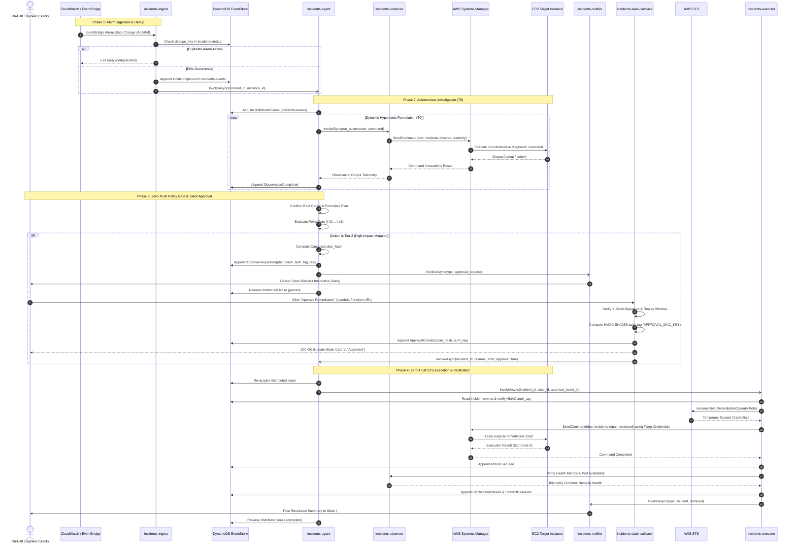

# AWS Lambda Serverless Entrypoints (`handlers/`)

This directory houses the **6 AWS Lambda Serverless entrypoints** and the unified dependency injection runtime (`shared.py`) that power the **Autonomous Cloud Incident Remediation System**.

The serverless tier is architected under strict **Zero-Trust Least Privilege** principles:
- No single Lambda function possesses blanket administrative or SSM execution permissions.
- Operational roles are strictly separated between **Observation (T0)**, **Decision Reasoning (Agent)**, and **Remediation Execution (T1/T2)**.
- Communication across Lambda boundaries is asynchronous and decoupled via DynamoDB event sourcing, cryptographic HMAC authorization tags, and EventBridge triggers.

---

## 1. The 6 Serverless Lambda Functions & Shared Runtime

```
handlers/
├── ingest.py          <── CloudWatch Alarm ingestion, deduplication & incident initiation
├── agent.py           <── Autonomous reasoning loop runner, lease management & orchestrator
├── observer.py        <── Isolated T0 read-only SSM diagnostic executor & CloudWatch telemetry
├── executor_fn.py     <── Zero-Trust STS remediation operator (T1/T2 SSM repair & verification)
├── notifier.py        <── Resilient Slack BlockKit dispatcher with graceful skip fallback
├── slack_callback.py  <── Public Function URL for human-in-the-loop HMAC approval processing
└── shared.py          <── Warm-start client caching, dependency injection & Secrets Manager resolver
```

### Handlers Specification & Role Matrix

| Handler File | Logical Lambda | Trigger / Invocations | IAM Execution Boundary & Zero-Trust Role | Core Architectural Responsibilities |
|---|---|---|---|---|
| [`ingest.py`](ingest.py) | `incidents-ingest` | EventBridge Rule (`CloudWatch Alarm State Change` -> `ALARM`) | `LambdaIngestRole`<br/>• `dynamodb:PutItem` on `incidents-dedup` & `incidents-events`<br/>• `lambda:InvokeFunction` on `incidents-agent` | • Extracts `alarm_name`, `instance_id`, `description`, and ARN from EventBridge or SNS wrapped payloads.<br/>• Computes atomic deduplication key (`alarm::{name}::{instance}`).<br/>• Persists `IncidentOpened` event via `store.create_if_absent`.<br/>• Recovers stale dedupe locks automatically if prior approval expired (>15 min) or incident resolved/abandoned.<br/>• Dispatches asynchronous invocations to `incidents-notifier` and `incidents-agent` with verbose diagnostic logging. |
| [`agent.py`](agent.py) | `incidents-agent` | Asynchronous Lambda invocation (from `ingest` or `slack_callback`) | `LambdaAgentRole`<br/>• Read/Write on DynamoDB (`events`, `leases`)<br/>• Read/Write on S3 Blobs Bucket<br/>• `lambda:InvokeFunction` on `observer`, `executor`, `notifier`<br/>• **NO `ssm:SendCommand`** permissions | • Manages distributed leases (`incidents-leases`) with automatic TTL renewal.<br/>• Runs iterative `ReasoningLoop.step()` with timeout protection (`SAFETY_MARGIN_SECONDS = 30s`).<br/>• Formulates hypotheses and requests read-only telemetry from `observer`.<br/>• Evaluates proposed remediation plans against the 16 Policy Invariants (`I-01` .. `I-16`).<br/>• Coordinates human approval requests for Tier-2 mutations. |
| [`observer.py`](observer.py) | `incidents-observer` | Synchronous invocation from `agent` via `ProxyObserveBackend` | `LambdaObserverRole`<br/>• `ssm:SendCommand` restricted exclusively to document `incidents-observe-readonly`<br/>• `cloudwatch:GetMetricData`, `cloudwatch:DescribeAlarms`<br/>• `logs:FilterLogEvents` | • **Sole holder of observation SSM capabilities** (Zero-Trust isolation).<br/>• Executes non-mutating shell inspections (`df`, `ps`, `lsof`, `journalctl`).<br/>• Captures live CloudWatch metric series and log streams.<br/>• Enforces strict per-command execution timeouts. |
| [`executor_fn.py`](executor_fn.py) | `incidents-executor` | Asynchronous invocation from `agent` upon policy clearance | `LambdaExecutorRole`<br/>• `sts:AssumeRole` into `RemediationOperatorRole`<br/>• Read/Write on `incidents-events`<br/>• `lambda:InvokeFunction` on `notifier` | • Does **not** hold direct SSM permissions in its execution role.<br/>• Uses AWS STS to assume `RemediationOperatorRole` (`incidents-ssm-exec-role`).<br/>• For Tier-2 actions: validates the cryptographic HMAC-SHA256 authorization tag (`compute_auth_tag`).<br/>• Dispatches targeted SSM mutations using `incidents-repair-restricted` against instances tagged `IncidentsAgent=true`.<br/>• Executes automated health verification (`Verifier`) and coordinates rollback (`Reconciler`) upon failure. |
| [`notifier.py`](notifier.py) | `incidents-notifier` | Asynchronous invocation from `agent` or `executor` | `LambdaNotifierRole`<br/>• `secretsmanager:GetSecretValue` for Slack secrets | • Formats rich interactive Slack BlockKit payloads for incident states.<br/>• Routes operational alerts to `#incidents-alerts` and approval requests to `#incidents-approval`.<br/>• Generates interactive Approve / Reject action buttons embedding incident and step metadata.<br/>• **100% Graceful Skip**: If Slack tokens/webhooks are unconfigured, logs diagnostic info and exits cleanly without throwing errors. |
| [`slack_callback.py`](slack_callback.py) | `incidents-slack-callback` | HTTPS POST via Lambda Function URL (`AuthType: NONE` with HMAC signature validation) | `LambdaSlackCallbackRole`<br/>• Read/Write on `incidents-events`<br/>• `secretsmanager:GetSecretValue`<br/>• `lambda:InvokeFunction` on `incidents-agent` | • Verifies Slack request signatures (`X-Slack-Signature`, `X-Slack-Request-Timestamp`) within a 5-minute replay window.<br/>• Provides immediate HTTP 200 ACK within Slack's mandatory 3-second timeout constraint.<br/>• Validates human decision payload and computes cryptographic HMAC `auth_tag`.<br/>• Appends `ApprovalGranted` or `ApprovalDenied` to `incidents-events`.<br/>• Asynchronously re-invokes `incidents-agent` to resume the remediation workflow. |
| [`shared.py`](shared.py) | *Runtime Library* | Imported by all Lambda handlers | N/A (Embedded Module) | • **Warm-Start Optimization**: Caches `boto3` clients, `DynamoDBEventStore`, and LLM client instances.<br/>• **Resilient Secret Resolution**: `_resolve_secret` queries environment variables first, then resolves from AWS Secrets Manager with `@lru_cache`.<br/>• Exposes unified invocation primitives (`invoke_async`, `invoke_sync`). |

---

## 2. End-to-End Event Flow & HMAC Approval Sequence

The following sequence diagram illustrates the lifecycle of an incident: from initial CloudWatch alarm ingestion, through read-only observation, policy evaluation, interactive Slack human-in-the-loop approval, zero-trust STS execution, and automated post-remediation verification.



---

## 3. Security Boundaries & Zero-Trust Design Patterns

### 1. Separation of Privilege
- **Agent Sandbox**: The reasoning engine (`incidents-agent`) has access to LLMs and state storage, but **zero SSM permissions**. Even if an LLM is prompted adversarial inputs, it cannot issue commands directly to cloud infrastructure.
- **Dedicated Observer**: `incidents-observer` can only invoke the read-only SSM document `incidents-observe-readonly`. It cannot modify files, restart processes, or install packages.
- **Dynamic Role Assumption**: `incidents-executor` holds no permanent SSM permissions. It obtains temporary short-lived credentials via `sts:AssumeRole` (`RemediationOperatorRole`) only when executing an authorized step.

### 2. Cryptographic HMAC Approval Token Pipeline
Human approval decisions are tamper-proof and cryptographically verified:
1. When a Tier-2 remediation step is planned, the system derives an immutable canonical JSON representation of the command and its targets:
   $$\text{plan\_hash} = \text{SHA256}(\text{canonical\_json}(\text{step}))$$
2. Upon human approval via Slack, `incidents-slack-callback` verifies the Slack HMAC signature, then generates a secondary authentication tag using a dedicated HMAC key (`APPROVAL_MAC_KEY`):
   $$\text{auth\_tag} = \text{HMAC-SHA256}(\text{APPROVAL\_MAC\_KEY}, \text{plan\_hash} \parallel \text{incident\_id} \parallel \text{step\_id})$$
3. Before `incidents-executor` triggers SSM, it recalculates the plan hash and validates the HMAC tag. Any modification of the command string in transit results in an immediate invariant violation (`I-14`), aborting execution.

### 3. Graceful Slack Resilience
- Handlers do not hardcode external communication dependencies.
- If Slack secrets (`SLACK_WEBHOOK_URL` or `SLACK_BOT_TOKEN`) are missing or unconfigured in AWS Secrets Manager, `notifier.py` logs an informational notice and skips delivery cleanly (`ok({"skipped": True})`).
- This design allows full end-to-end operation, automated recovery, and conformance testing in headless CI/CD environments without external Slack workspaces.

### 4. Fail-Closed Approval Expiration (`SLACK_APPROVAL_TIMEOUT=300`)
- Human approval windows default to **300 seconds (5 minutes)**.
- If an on-call engineer does not respond within this window or explicitly denies the request:
  - The system enforces a strict **Fail-Closed** security posture.
  - No mutation is executed against the target infrastructure.
  - An `EventType.Escalated` event is recorded in DynamoDB, and the incident transitions safely to `IncidentPhase.escalated`.

