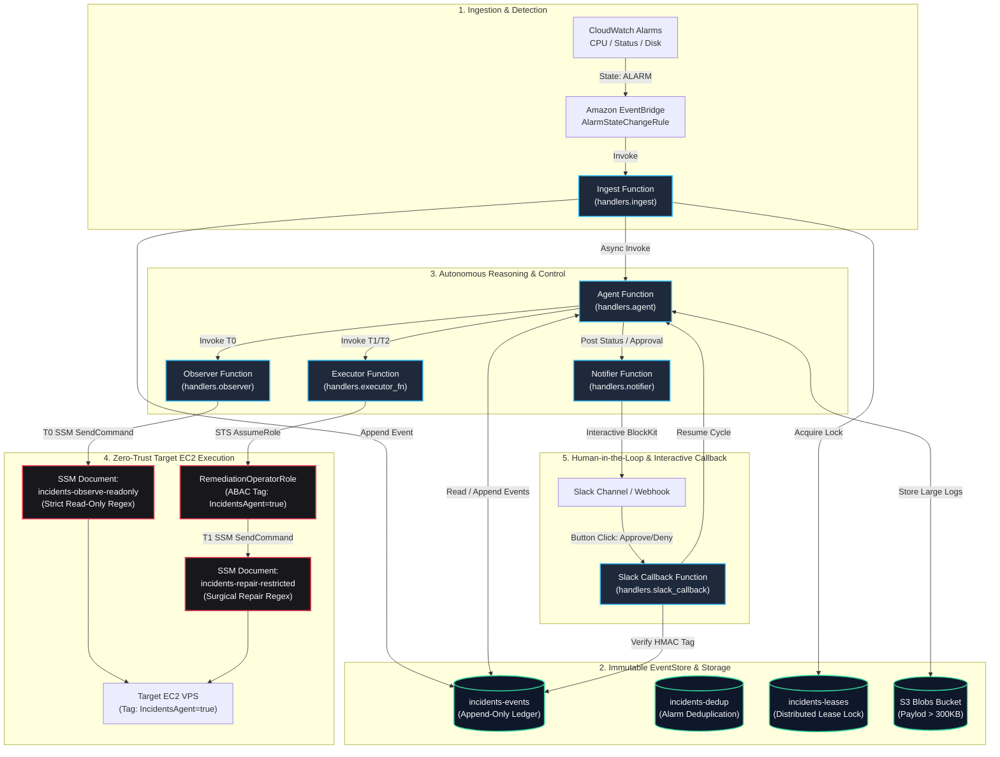

# Infrastructure as Code (IaC) & Zero-Trust AWS Architecture

This directory defines the Infrastructure as Code (IaC) assets, Zero-Trust AWS Systems Manager (SSM) command documents, and policy enforcement templates for the **Autonomous Cloud Incident Remediation System**.

The infrastructure is provisioned and managed via [AWS Serverless Application Model (SAM)](https://aws.amazon.com/serverless/sam/) using [`template.yaml`](../template.yaml), designed around the principles of **least privilege**, **zero-trust execution boundaries**, **append-only auditability**, and **complete regional independence**.

---

## 1. Infrastructure Overview & System Topology

The system comprises 6 specialized serverless micro-functions, an append-only DynamoDB event store, a dedicated S3 large-blob repository, Zero-Trust SSM documents, and EventBridge orchestration rules.



### Serverless Functions Breakdown

| Function Name | Handler | Memory / Timeout | Architectural Responsibility |
|---|---|---|---|
| **`incidents-ingest`** | `handlers.ingest.handler` | 256 MB / 30s | Filters EventBridge alarm state changes, enforces alarm deduplication, claims the distributed incident lease, and initiates the investigation loop. |
| **`incidents-agent`** | `handlers.agent.handler` | 512 MB / 900s | Core reasoning orchestrator. Executes iterative hypothesis generation, evaluates policy invariants (I-01 through I-16), and dispatches observation/remediation steps. |
| **`incidents-observer`** | `handlers.observer.handler` | 256 MB / 90s | Read-only observation executor (Tier T0). Dispatches unprivileged inspection commands via AWS Systems Manager. |
| **`incidents-executor`** | `handlers.executor_fn.handler` | 256 MB / 300s | Remediation executor (Tier T1/T2). Validates cryptographic HMAC authorization tokens before assuming the remediation role and executing surgical repair commands. |
| **`incidents-notifier`** | `handlers.notifier.handler` | 128 MB / 30s | Formats multi-channel incident briefs and interactive Slack BlockKit approval dialogs. |
| **`incidents-slack-callback`**| `handlers.slack_callback.handler`| 128 MB / 10s | Authenticates external Slack interactive payloads via Lambda Function URL (`NONE` auth with HMAC verification) and appends decisions to the event store. |

---

## 2. Zero-Trust AWS SSM Documents (`infra/ssm/`)

Direct SSH/RDP access to target instances is prohibited. All host interactions are mediated by Zero-Trust AWS Systems Manager (SSM) Command Documents configured in [`infra/ssm/`](ssm/).

### A. Observation Document: `incidents-observe-readonly` (Tier T0)
* **File:** [`infra/ssm/incidents-observe-readonly.json`](ssm/incidents-observe-readonly.json)
* **Schema Version:** `2.2` (Command Document)
* **Execution Timeout:** 60 seconds
* **Security Model:** **Strict Command Allowlist Regex**. Commands must match the allowed pattern before the SSM agent accepts them:
  ```regex
  ^(sudo )?(df|du|free|top|ps|cat|head|tail|ls|stat|find|systemctl|journalctl|dmesg|uptime|netstat|ss|lsof|wc|grep|curl|pgrep|mpstat|vmstat|pidstat|echo|date|id|whoami|uname|hostname).*
  ```
* **Injection Defense:** The document prevents arbitrary shell execution, piped mutation sequences, or unauthorized network egress outside safe observation tools.

### B. Remediation Document: `incidents-repair-restricted` (Tier T1/T2)
* **File:** [`infra/ssm/incidents-repair-restricted.json`](ssm/incidents-repair-restricted.json)
* **Schema Version:** `2.2` (Command Document)
* **Execution Timeout:** 120 seconds
* **Security Model:** **Surgical Mutation Allowlist Regex**:
  ```regex
  ^(sudo )?(systemctl restart|systemctl start|systemctl stop|systemctl reload|rm -f|truncate|mv|kill|pkill).*
  ```
* **Attribute-Based Access Control (ABAC):** Executed exclusively via `RemediationOperatorRole`. The IAM policy explicitly requires that the target instance carry the security tag:
  ```json
  "Condition": {
    "StringEquals": {
      "ssm:resourceTag/IncidentsAgent": "true"
    }
  }
  ```
  Any attempt to invoke repair commands against unapproved or client-owned production instances lacking this tag is denied at the AWS IAM evaluation layer.

---

## 3. Conditional IaC & Delta Resolution Matrix

The CloudFormation template (`template.yaml`) is built for **universal adaptability**. It can adopt pre-existing enterprise resources without collisions (**Option A: Brownfield**) or provision an entirely dedicated greenfield environment (**Option B: Greenfield via `-T`**).

| Parameter | Type / Default | Delta Resolution Logic | Brownfield (Option A) | Dedicated Greenfield (Option B) |
|---|---|---|---|---|
| `CreateDynamoTables` | String (`true`) | Checks if `incidents-events`, `incidents-dedup`, and `incidents-leases` exist. | `false` (Reuses existing tables) | `true` (Creates new PAY_PER_REQUEST tables) |
| `CreateBlobsBucket` | String (`true`) | Checks if bucket exists or `--existing-bucket` is provided. | `false` (Adopts specified bucket) | `true` (Provisions `incidents-blobs-${AWS::AccountId}`) |
| `ExistingBlobsBucketName` | String (`""`) | Receives bucket name when adopting existing storage. | `<client-bucket-name>` | `""` (Omitted from SAM deploy parameters) |
| `CreateSsmDocuments` | String (`true`) | Audits SSM document existence and drift against `infra/ssm/*.json`. | `false` (Reuses existing documents) | `true` (Installs zero-trust command documents) |
| `CreateCoreIamRoles` | String (`true`) | Audits existence of `incidents-agent-role`, `incidents-observer-role`, etc. | `false` (Uses existing client IAM roles) | `true` (Creates isolated IAM execution roles) |
| `EnableAlarms` | String (`false`) | Enables standard EC2 CloudWatch alarms (CPU, StatusCheckFailed). | `true` if `--instance-id` passed | `true` (Configured for provisioned instance) |
| `EnableDiskAlarm` | String (`false`) | Checks if instance emits CloudWatch `CWAgent` metric `disk_used_percent`. | `true` if metric exists, else `false` | `false` on vanilla AMIs until CWAgent installed |
| `StrandsUrl` | String (`embedded`) | Selects between external microservice and in-memory neural routing. | User URL or `embedded` | `embedded` (Self-contained, zero EC2 dependency) |

---

## 4. Region-Independent LLM Inference & SCP Immunity

In enterprise environments, accounts frequently operate under strict **Service Control Policies (SCPs)** that restrict available regions (e.g., locking workloads to `eu-north-1` Stockholm or `eu-west-1` Ireland).

### Architectural Decisions in `template.yaml`:
1. **Zero Hardcoded Cross-Region IAM Policies:**
   * Many AWS Bedrock models reside in `us-east-1` or `us-west-2`. Creating cross-region IAM policies (e.g., `arn:aws:iam::...:policy/BedrockCrossRegion`) inside templates deployed in `eu-north-1` triggers immediate SCP `AccessDenied` errors.
   * `template.yaml` defines **zero Bedrock IAM policies**.
2. **BYOK (Bring Your Own Key) over HTTPS Bearer Auth:**
   * LLM inference connects via standard HTTPS Bearer Token authentication (`DeepSeekModel`) using an OpenAI-compatible endpoint (such as Amazon Bedrock Mantle / QuickStart or private inference gateways).
   * API keys are stored locally within the deployed region's Secrets Manager (`/incidents/deepseek-api-key`), allowing complete region independence and immunity to SCP regional lockouts.

---

## 5. Least-Privilege IAM & Immutable EventStore

### Append-Only EventStore Enforcement
The system's integrity relies on Invariant **I-05** (Immutable Append-Only Audit Trail). The IAM policy for `incidents-events` strictly permits:
* `dynamodb:GetItem`
* `dynamodb:PutItem`
* `dynamodb:Query`
* `dynamodb:DescribeTable`

**Crucially, `dynamodb:DeleteItem` and `dynamodb:UpdateItem` are omitted from the `incidents-events` policy.** No Lambda function or operator can modify or erase historical incident evidence.

### Role Dependency & Construction Sequencing
To prevent race conditions during parallel CloudFormation deployments:
* `RemediationOperatorRole` defines an explicit trust relationship with the executor role:
  ```yaml
  Principal:
    AWS: !GetAtt ExecutorRole.Arn
  ```
  Using `!GetAtt ExecutorRole.Arn` enforces strict CloudFormation resource dependency ordering, ensuring `ExecutorRole` finishes creation before IAM attempts to validate the trust policy of `RemediationOperatorRole`.

---

## 6. Verification & Deployment Commands

To validate and test the infrastructure definitions locally:

```bash
# 1. Lint CloudFormation and verify best practices
cfn-lint template.yaml

# 2. Validate SAM syntax
sam validate --lint

# 3. Build serverless artifacts
sam build

# 4. Deploy to target AWS account & region
sam deploy \
  --stack-name incidents-agent-core \
  --region eu-north-1 \
  --resolve-s3 \
  --capabilities CAPABILITY_IAM CAPABILITY_NAMED_IAM \
  --no-fail-on-empty-changeset
```
