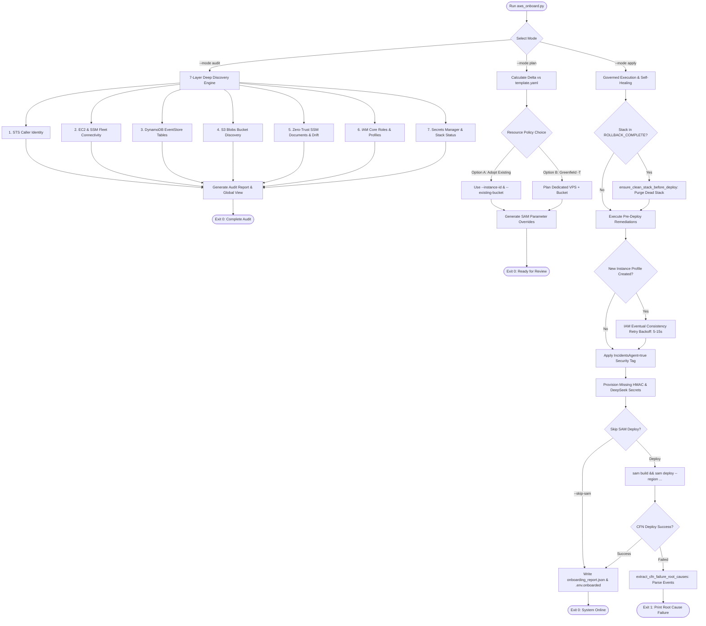

# Autonomous AWS Onboarding & Delta Provisioning CLI (`scripts/`)

This directory houses [`aws_onboard.py`](aws_onboard.py), a production-grade, multi-stage AWS environment discovery, planning, and delta-provisioning CLI engineered to automate onboarding client AWS accounts onto the **Autonomous SecOps Incident Remediation Engine**.

The tool operates with zero intrusive assumptions, enforcing a strict separation between **Read-Only Discovery (`audit`)**, **Idempotent Parameter Planning (`plan`)**, and **Governed Remediation & Deployment (`apply`)**.

---

## 1. Onboarding & Provisioning Lifecycle (Mermaid Flowchart)



---

## 2. The 7-Layer Deep Discovery Engine (`--mode audit`)

When invoked in `--mode audit`, `aws_onboard.py` performs a read-only interrogation across 7 distinct AWS infrastructure layers. It makes zero mutations and returns an architectural assessment of the target environment.

| Layer | Audit Function | Target Resources & API Invocations | Architectural Discovery Objective |
|---|---|---|---|
| **1. Identity** | `audit_identity` | `sts:GetCallerIdentity` | Validates active AWS credentials, captures Account ID, IAM User/Role ARN, and verifies regional API connectivity. |
| **2. Compute & SSM** | `audit_ec2` | `ec2:DescribeInstances`<br/>`ssm:DescribeInstanceInformation`<br/>`cloudwatch:ListMetrics` | Enumerates running EC2 instances, inspects attached IAM instance profiles, checks SSM Fleet Manager `PingStatus == "Online"`, checks for the `IncidentsAgent=true` security tag, and probes for CloudWatch Agent disk metrics (`CWAgent`). Detects running Strands Decider instances. |
| **3. EventStore** | `audit_dynamodb` | `dynamodb:DescribeTable` | Inspects core EventStore tables: `incidents-events`, `incidents-dedup`, and `incidents-leases`. Validates primary key schemas (`incident_id`, `dedupe_key`), partition keys, and billing modes (`PAY_PER_REQUEST`). |
| **4. Storage Blobs** | `audit_s3_bucket` | `s3:GetBucketEncryption`<br/>`s3:ListBuckets` | Checks for the default large-blob offload bucket `incidents-blobs-<account_id>` and validates AES256 server-side encryption. Discovers existing customer S3 buckets to support zero-footprint adoption. |
| **5. Zero-Trust SSM** | `audit_ssm` | `ssm:DescribeDocument`<br/>`ssm:GetDocument` | Audits Zero-Trust documents `incidents-observe-readonly` and `incidents-repair-restricted`. Performs **Regex Drift Detection** to verify that parameter validation patterns match the exact repository specification. |
| **6. IAM Security** | `audit_iam` | `iam:GetRole`<br/>`iam:GetInstanceProfile` | Validates existence of `IncidentsSSMExecutionRole` (`RemediationOperatorRole`) and `IncidentsTargetSSMInstanceProfile`. |
| **7. Secrets & Stack** | `audit_secrets_and_stack` | `secretsmanager:DescribeSecret`<br/>`cloudformation:DescribeStacks` | Audits required encryption and LLM keys (`/incidents/approval-mac-key`, `/incidents/deepseek-api-key`, Slack tokens). **Detects placeholder secrets** transparently. Inspects CloudFormation stack `autonomous-secops-agent` and verifies associated Lambda functions and EventBridge rules. |

---

## 3. Universal Client Resource Choice Policy

To prevent unintended modifications to existing production workloads, `aws_onboard.py` enforces a **Universal Client Resource Choice Policy**. The CLI never auto-selects or mutates existing customer instances or buckets without explicit instruction:

### Option A: Adopt Existing Client Resources (Non-Intrusive Brownfield)
Designed for enterprise clients integrating the agent into an existing environment without deploying new servers or storage:
* **Target EC2 Instance**: Pass `--instance-id <INSTANCE_ID>`. The CLI inspects the server, verifies SSM connectivity, and attaches the `IncidentsAgent=true` tag.
* **Brownfield Telemetry Auto-Bootstrap**: In `--mode apply`, the CLI uses AWS Systems Manager (`AWS-RunShellScript`) to automatically bootstrap `amazon-cloudwatch-agent` and the native systemd health timer (`cwsys_health.timer`) on the existing server in-place with **Zero Downtime and Zero Reboot**. It automatically attaches `CloudWatchAgentServerPolicy` to any existing IAM profile and enables all 5 production alarms (`High-CPU`, `StatusCheckFailed`, `High-Disk`, `High-Memory`, and decoupled `System-Degraded`).
* **Storage Bucket**: Pass `--existing-bucket <BUCKET_NAME>`. The tool sets SAM parameter `CreateBlobsBucket=false` and configures the agent to use the client's existing bucket for large incident telemetry blobs.
* **LLM Secrets**: Pass `--deepseek-api-key <KEY>` to securely store credentials into the client's AWS Secrets Manager (`/incidents/deepseek-api-key`).

### Option B: Greenfield Isolated Environment via `-T` (Zero-Touch Dedicated)
Designed for rapid proof-of-concept testing, training, or isolated sandboxing:
* Passing `-T` or `--create-target-vps` provisions a completely isolated, standalone environment:
  1. Creates an EC2 instance (`t3.micro` / `t4g.micro`) with automated multi-distro package manager detection (`dnf`, `apt-get`, `yum`).
  2. Creates and attaches `IncidentsTargetSSMInstanceProfile` with dual least-privilege IAM policies:
     * `AmazonSSMManagedInstanceCore` (Zero-Trust SSM execution & observation).
     * `CloudWatchAgentServerPolicy` (CloudWatch Agent and `put-metric-data` telemetry ingestion).
  3. Installs and enables the `nginx` web server as a sample production workload.
  4. Automatically configures and launches `amazon-cloudwatch-agent` with unified `"aggregation_dimensions": [["InstanceId"]]` to eliminate EBS/NVMe disk device name fragmentation (`nvme` vs `xvda`).
  5. Deploys the **Universal Native Systemd Health Pulse** (`cwsys_health.service` & `cwsys_health.timer`), running every 60 seconds with zero `cron`/`cronie` dependency across Ubuntu, Debian, AL2023, and RHEL.
  6. Automatically tags the instance with `IncidentsAgent=true`.
  7. Waits for SSM Fleet Manager to report the instance status as `Online`.
  8. Directs CloudFormation to create a dedicated S3 blobs bucket (`CreateBlobsBucket=true`) and automatically enables all 5 CloudWatch alarms (`EnableAlarms=true`, `EnableDiskAlarm=true`).

---

## 4. Production Self-Healing & CloudFormation Resilience

During `--mode apply`, `aws_onboard.py` incorporates autonomous self-healing routines to eliminate common real-world deployment blockers:

### 1. IAM Eventual Consistency Retry Backoff
When creating `IncidentsTargetSSMInstanceProfile` in distant AWS regions (e.g. `eu-north-1`), IAM metadata propagation to the regional EC2 API can take 5 to 15 seconds. If `ec2.run_instances` or `ec2.associate_iam_instance_profile` is called immediately, AWS throws `InvalidParameterValue (iamInstanceProfile.name is invalid)`.
* **Remediation**: The CLI implements exponential retry backoff with jitter, catching `ClientError` and re-attempting profile association up to 5 times until IAM propagation converges.

### 2. Dead Stack Self-Healing (`ensure_clean_stack_before_deploy`)
If a prior CloudFormation deployment failed during initial stack creation, AWS places the stack in `ROLLBACK_COMPLETE` or `DELETE_FAILED`. In this state, subsequent `sam deploy` calls immediately fail because CloudFormation cannot update a failed-creation stack.
* **Remediation**: The CLI inspects the stack status before invoking SAM. If stuck in `ROLLBACK_COMPLETE`, it automatically executes `cloudformation.delete_stack`, polls until deletion completes, and provisions a clean stack.

### 3. Forensic Root-Cause Failure Extraction (`extract_cfn_failure_root_causes`)
When `sam deploy` fails, standard tooling frequently outputs generic errors like `Waiter StackCreateComplete failed: ROLLBACK_COMPLETE`.
* **Remediation**: The CLI intercepts stack creation failures, queries `describe_stack_events`, filters for `ResourceStatus.endswith('FAILED')` (excluding generic cancellation messages), and prints the exact logical resource and AWS service error message (e.g., `[AgentFunction (AWS::Lambda::Function)] -> Specified ReservedConcurrentExecutions decreases unreserved concurrency below minimum`).

### 4. Strict `.env` Isolation & Placeholder Detection
The CLI inspects environment configurations and AWS Secrets Manager for unpopulated placeholder values (e.g. `YOUR_KEY_HERE`, `placeholder`). It flags unconfigured Slack webhooks or LLM tokens transparently and outputs a sanitized `.env.onboarded` file with zero secrets leaked.

### 5. Universal Native Systemd Health Pulse (Crash & Clean Stop Dual Detection)
Traditional monitoring scripts either fail on distributions lacking `cronie` (such as Amazon Linux 2023) or only detect abnormal crashes via `systemctl --failed` while ignoring manual or administrative service stops (`systemctl stop`).
* **Remediation**: `aws_onboard.py` deploys a native Linux Systemd Timer (`cwsys_health.timer`) running every 60 seconds with IMDSv2 token security. It calculates:
  $$\text{Failed Services} = \text{failed units count} + \text{enabled but inactive critical daemons count}$$
  This emits `FailedServicesCount` directly to the `CWAgent` CloudWatch namespace, guaranteeing that both unhandled application crashes and stopped services trigger an immediate `ALARM` state within 60 seconds.

---

## 5. CLI Reference & Command Examples

### CLI Options

| Argument | Flag | Description | Default |
|---|---|---|---|
| `--mode` | N/A | Execution mode: `audit` (read-only discovery), `plan` (calculate SAM parameters), `apply` (remediate & deploy). | `audit` |
| `--region` | N/A | Target AWS Region. | `$AWS_REGION` or `us-east-1` |
| `--create-target-vps` | `-T` | Provisions a dedicated greenfield EC2 instance (AL2023 + Nginx + SSM) with tag `IncidentsAgent=true`. | `False` |
| `--instance-id` | N/A | Adopts an existing EC2 instance ID for autonomous remediation. | `""` |
| `--existing-bucket` | N/A | Adopts an existing customer S3 bucket for incident blobs (disables automatic bucket creation). | `""` |
| `--deepseek-api-key` | N/A | Stores a DeepSeek API key into Secrets Manager (`/incidents/deepseek-api-key`). | `""` |
| `--stack-name` | N/A | CloudFormation / SAM stack name. | `autonomous-secops-agent` |
| `--strands-url` | N/A | URL for external Strands Decider service or `embedded` for in-memory router. | `embedded` |
| `--global-view` | N/A | Scans all enabled AWS regions for running EC2 instances and EventStore tables. | `False` |
| `--skip-sam` | N/A | Executes pre-deploy remediation and generates receipts without invoking `sam deploy`. | `False` |
| `--yes` | N/A | Automatically proceeds with apply actions without interactive confirmation. | `False` |
| `--json-out` | N/A | Path to write machine-readable JSON audit report or deployment receipt. | `""` |
| `--env-out` | N/A | Path to generate sanitized environment variables configuration file. | `""` |

---

### Command Examples

#### 1. Full Multi-Region Read-Only Discovery
```bash
python3 scripts/aws_onboard.py --mode audit --region us-east-1 --global-view
```

#### 2. Brownfield Inspection on Existing EC2 Instance
```bash
python3 scripts/aws_onboard.py --mode audit \
    --region us-east-1 \
    --instance-id <TARGET_INSTANCE_ID> \
    --json-out audit_report.json
```

#### 3. Greenfield Deployment with Dedicated Target Server (`-T`)
```bash
python3 scripts/aws_onboard.py --mode apply \
    --region us-east-1 \
    -T \
    --deepseek-api-key "sk-proj-xxxx" \
    --yes
```

#### 4. Brownfield Governed Deployment (Adopt Existing Server & Bucket)
```bash
python3 scripts/aws_onboard.py --mode apply \
    --region eu-north-1 \
    --instance-id <TARGET_INSTANCE_ID> \
    --existing-bucket my-company-audit-logs \
    --deepseek-api-key "sk-proj-xxxx" \
    --yes
```

#### 5. Generate Pre-Deploy Remediation Receipts Without Deploying SAM
```bash
python3 scripts/aws_onboard.py --mode apply \
    --region us-east-1 \
    -T \
    --skip-sam \
    --env-out .env.onboarded
```
