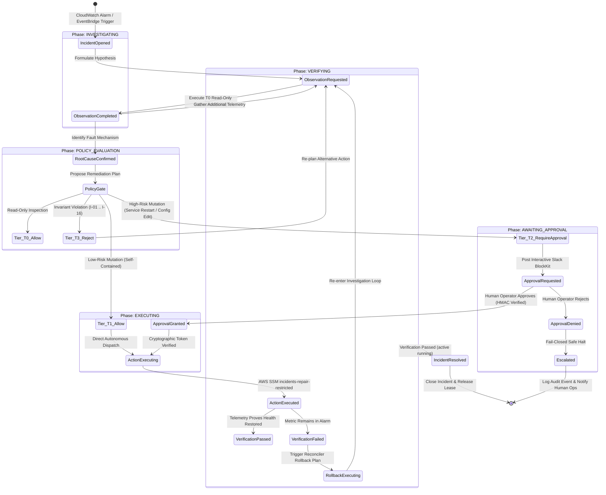

# Core Autonomous SecOps Engine (`src/`)

This directory contains the pure, platform-independent core reasoning engine, security policy gate, domain reducer, storage adapters, and execution primitives of the **Autonomous Cloud Incident Remediation System**.

The engine is engineered following **Hexagonal Architecture (Ports and Adapters)** principles. The core domain logic is strictly decoupled from cloud providers, messaging protocols, and infrastructure runtimes, enabling deterministic unit testing, multi-backend conformance verification, and zero-runbook dynamic reasoning.

---

## 1. Clean Hexagonal Architecture (`src/` Modules)

The codebase is organized into 8 focused subsystems with unidirectional dependencies flowing inward toward the pure domain:

```text
src/
├── domain/        <── Core Domain State, Invariant Types & Deterministic Reducer
├── policy/        <── Zero-Trust Policy Gate, 16 Invariants & Cryptographic HMAC Auth
├── agent/         <── Autonomous Reasoning Loop, Strands Decider & Multi-Tier Model Router
├── store/         <── Unified EventStore Layer (DynamoDB, SQLite, Memory) & S3 Blobs
├── executor/      <── Secure Execution Engine, SSM/Docker Lab, Verifier & Reconciler
├── conformance/   <── Cross-Backend Conformance Test Suite (DynamoDB / SQLite / Memory)
├── eval/          <── Evaluation Harness, Recorded Benchmark Scenarios & Metrics
└── lab/           <── Local Simulation Scenarios for Fault Injection
```

### Module Responsibilities

| Subsystem | Primary Files | Architectural Responsibility |
|---|---|---|
| **`domain/`** | [`types.py`](domain/types.py)<br/>[`reducer.py`](domain/reducer.py) | **Pure Core Domain**. Contains immutable dataclasses (`IncidentState`, `EventRecord`, `StepRecord`, `PolicyDecisionPayload`), strongly-typed enumerations (`IncidentPhase`, `StepKind`, `Tier`), and the pure event reducer `fold(events) -> IncidentState` that computes the entire system state deterministically with zero side effects. |
| **`policy/`** | [`gate.py`](policy/gate.py)<br/>[`invariants.py`](policy/invariants.py)<br/>[`auth.py`](policy/auth.py)<br/>[`plan_hash.py`](policy/plan_hash.py) | **Security Boundary**. Evaluates every proposed action against 16 immutable security invariants (`I-01` .. `I-16`). Computes deterministic canonical plan hashes (`compute_plan_hash`) and cryptographic approval authentication tags (`compute_auth_tag` via HMAC-SHA256). Classifies steps into Tiers (T0 Read-Only, T1 Surgical Safe, T2 High-Impact Human Approval, T3 Absolute Rejection). |
| **`agent/`** | [`loop.py`](agent/loop.py)<br/>[`tool_decider.py`](agent/tool_decider.py)<br/>[`model_router.py`](agent/model_router.py)<br/>[`deepseek_model.py`](agent/deepseek_model.py)<br/>[`nova_model.py`](agent/nova_model.py) | **Autonomous Reasoning Engine**. Implements the iterative observation-hypothesis-action reasoning loop (`ReasoningLoop`). Features **Strands Decider 2B** (`StrandsDeciderClient` / `EmbeddedStrandsDecider`) for rapid tool selection, and a **Dual-Tier Model Router** (`ModelRouter`) for generative argument synthesis. |
| **`store/`** | [`interface.py`](store/interface.py)<br/>[`dynamo_store.py`](store/dynamo_store.py)<br/>[`sqlite_store.py`](store/sqlite_store.py)<br/>[`memory.py`](store/memory.py) | **EventStore Storage Layer**. Unified storage interface (`EventStore`) enforcing append-only semantics, distributed incident leasing (`acquire_lease`, `renew_lease`), alarm deduplication (`check_and_set_dedup`), and transparent large-blob offloading to S3 when payloads exceed 300 KB. |
| **`executor/`**| [`executor.py`](executor/executor.py)<br/>[`ssm_lab.py`](executor/ssm_lab.py)<br/>[`verifier.py`](executor/verifier.py)<br/>[`reconciler.py`](executor/reconciler.py) | **Execution & Verification**. Executes approved steps via AWS SSM (`SSMLab`). Enforces pre-execution validation (`check_I_14_pre_execute`), verifies post-remediation health recovery (`Verifier`), and triggers automated rollback if invariants fail (`Reconciler`). |
| **`conformance/`**| [`suite.py`](conformance/suite.py) | **Conformance Testing**. Standardized conformance suite validating that all `EventStore` implementations (InMemory, SQLite, DynamoDB) strictly adhere to append-only ordering, idempotency, and concurrent lease invariants. |
| **`eval/`** | [`runner.py`](eval/runner.py)<br/>[`recordings.py`](eval/recordings.py) | **Evaluation Suite**. Replays historical recorded incidents (`recordings.py`) to measure agent reasoning accuracy, diagnostic speed, false-positive resistance, and MTTR without incurring live cloud costs. |

---

## 2. Autonomous State Machine & Investigation Lifecycle

Every incident progresses through a formal state machine governed by the pure reducer (`fold`). No intermediate mutable state is stored in memory; the state is derived exclusively from the immutable history of events.



---

## 3. Strands Decider 2B & Reasoning Architecture

### 3.1 Two-Tier Decider & Model Routing Pattern
To eliminate tool selection hallucinations and reduce inference latency by over 90%, the agent divides responsibilities:
1. **Strands Decider 2B (`StrandsDeciderClient` / `EmbeddedStrandsDecider`)**:
   * Evaluates the typed question across 5 discrete SecOps actions: `observe`, `query_metrics`, `update_hypotheses`, `propose_step`, `escalate`.
   * Returns a calibrated choice, confidence, and recommended model tier (`flash` vs `pro`) in **~115ms** (or sub-millisecond in embedded mode).
   * **Low-Confidence Safe Escalation**: If confidence drops below `0.15`, the engine refuses to guess and triggers immediate **Fail-Closed Safe Escalation**.
2. **Generative Foundation Model (Amazon Bedrock / DeepSeek)**:
   * Receives the chosen tool as a pinned hint.
   * Focuses purely on argument generation (e.g. constructing precise shell commands), slashing input/output tokens by ~60%.

> **Reusable Pattern Asset:** The standalone, portable implementation of this pattern is available at [`patterns/strands_secops_tool_selection/`](../patterns/strands_secops_tool_selection/README.md).

### 3.2 Anti-Hesitation Engine & Production Loop Guards
The reasoning loop in [`src/agent/loop.py`](agent/loop.py) enforces 4 hard production guards:
1. **Anti-Hesitation Guard**: When a model loops in repetitive hypothesis refinement at confidence $\ge 0.70$, the engine breaks analysis paralysis and forces a mutation proposal.
2. **Prerequisite Readiness Guard**: Prohibits starting a failed systemd unit until diagnostic telemetry (`status`, `journalctl`) has been inspected to uncover the root cause.
3. **Target Isolation Guard**: Forbids terminating healthy service PIDs when a service is `active (running)`, distinguishing legitimate processes from rogue port squatters.
4. **Cross-Round Deduplication & Fast-Path Conclude**: If an action (e.g. `systemctl restart <unit>`) already succeeded in a prior round and the unit is operational, the guard intercepts duplicate proposals across rounds and immediately redirects the agent to `conclude` as resolved.

---

<a id="4-the-16-security-invariants"></a>
## 4. The 16 Invariant Security Boundaries (`I-01` .. `I-16`)

Every step proposed by an LLM is intercepted and evaluated by `policy/invariants.py` before any execution occurs. A failure in any single invariant classifies the action as **Tier T3 (Absolute Rejection)**, which **cannot be bypassed even by human approval**.

| Invariant | Title | Policy Rule & Defense Mechanism |
|---|---|---|
| **`I-01`** | **SSM Agent Integrity** | Prohibits stopping, restarting, modifying, or tampering with the AWS Systems Manager agent (`amazon-ssm-agent`) or its configuration files (`/etc/amazon/ssm`). |
| **`I-02`** | **SSH & Access Protection** | Prohibits modifying SSH configuration (`/etc/ssh`), authorized keys (`/root/.ssh`, `/home/*/.ssh`), PAM authentication (`/etc/pam.d`), or access policies. |
| **`I-03`** | **Cloud Credentials & IMDS Isolation** | Prohibits calling AWS IAM APIs, modifying cloud credentials (`~/.aws/credentials`), or attempting to access the EC2 Instance Metadata Service (`http://169.254.169.254`). |
| **`I-04`** | **Network Boundary & Firewall Guard** | Prohibits altering host network routing tables, iptables, nftables, ufw, or security group rules that could sever connectivity. |
| **`I-05`** | **Audit Trail Preservation** | Prohibits deleting, truncating, or altering system audit records, auditd logs (`/var/log/audit`), or Amazon CloudWatch log files. |
| **`I-06`** | **User Account & Sudo Guard** | Prohibits creating, modifying, or deleting system accounts, passwords, shadow files (`/etc/passwd`, `/etc/shadow`), or sudoers configurations (`/etc/sudoers`). |
| **`I-07`** | **Remote Code & Package Install Guard** | Prohibits downloading and executing scripts from the internet (`curl | bash`, `wget | sh`) or invoking package managers (`apt`, `yum`, `dnf`, `pip`, `npm`). |
| **`I-08`** | **Critical Process Immunity** | Prohibits terminating PID 1 (`init` / `systemd`), core kernel threads, or critical system daemons (`sshd`, `amazon-ssm-agent`, `auditd`). |
| **`I-09`** | **System Shutdown & Host Termination** | Prohibits calling `shutdown`, `poweroff`, `halt`, `reboot`, or attempting EC2 instance termination via API calls. |
| **`I-10`** | **Engine Self-Modification Guard** | Prohibits modifying agent code, policy definitions, invariant rules (`policy/`), gate code, or runtime kill switches. |
| **`I-11`** | **Phase Separation Isolation** | Strictly isolates observation steps from remediation steps. No observation command may mutate host state; no mutation command may be run under observation privileges. |
| **`I-12`** | **Target Instance Confinement** | Prohibits executing actions against any resource or IP other than the explicit target EC2 instance designated for the active incident. |
| **`I-13`** | **Security Latch (Quarantine Lock)** | When security compromise indicators are detected (e.g. unauthorized crypto-miners, rootkits), mutations are locked (`security_latch=True`), freezing the system in read-only forensic mode. |
| **`I-14`** | **Cryptographic Policy Verification** | Enforces that no remediation action can execute without a pre-computed `PolicyDecisionPayload` cryptographically bound to the canonical `plan_hash`. |
| **`I-15`** | **Credential Exfiltration Defense** | Prohibits reading private keys (`.pem`, `.key`, `id_rsa`), database credentials, environment variable dumps (`/proc/*/environ`), or secrets during observation. |
| **`I-16`** | **Privilege Escalation Defense** | Prohibits setting `setuid`/`setgid` bits (`chmod +s`), spawning interactive root shells (`sudo -s`, `su -`), or bypassing execution privilege limits. |

---

## 5. Unified Storage Interface (`store/`)

The system implements the **Event Sourcing Pattern**. State is never updated in-place; state is always projected from an ordered stream of immutable domain events:

```python
from src.store.dynamo_store import DynamoDBEventStore
from src.domain.reducer import fold

# 1. Initialize store with distributed lease and deduplication
store = DynamoDBEventStore(
    table_name="incidents-events",
    dedup_table="incidents-dedup",
    leases_table="incidents-leases",
    blobs_bucket="incidents-blobs-123456789012"
)

# 2. Append domain events atomically
store.append(incident_id, current_seq, event_record)

# 3. Read complete stream and fold into current domain state
events = store.read(incident_id="inc-2026-001")
state = fold(events)

assert state.phase == IncidentPhase.investigating
assert len(state.hypotheses) > 0
```

* **Lease Locking (`incidents-leases`)**: Employs DynamoDB conditional expressions to guarantee that only a single worker agent executes cycles for an incident at any given second.
* **Large Blob Offloading**: When an observation output exceeds 300 KB, the store automatically compresses and offloads the raw stdout to the S3 Blobs bucket, replacing the event payload with an immutable S3 URI pointer.
